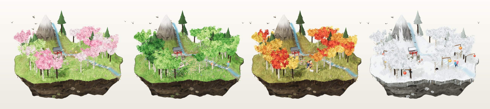
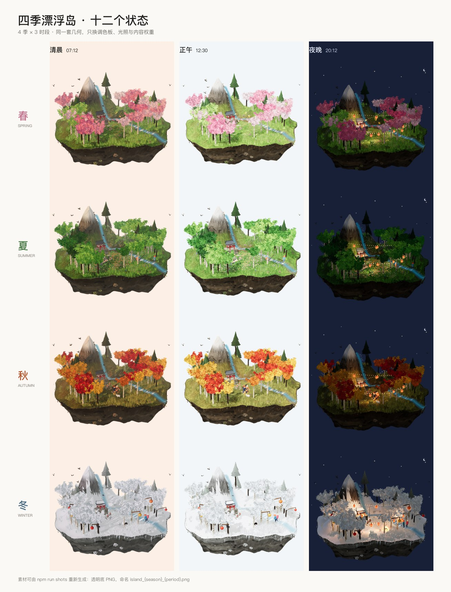
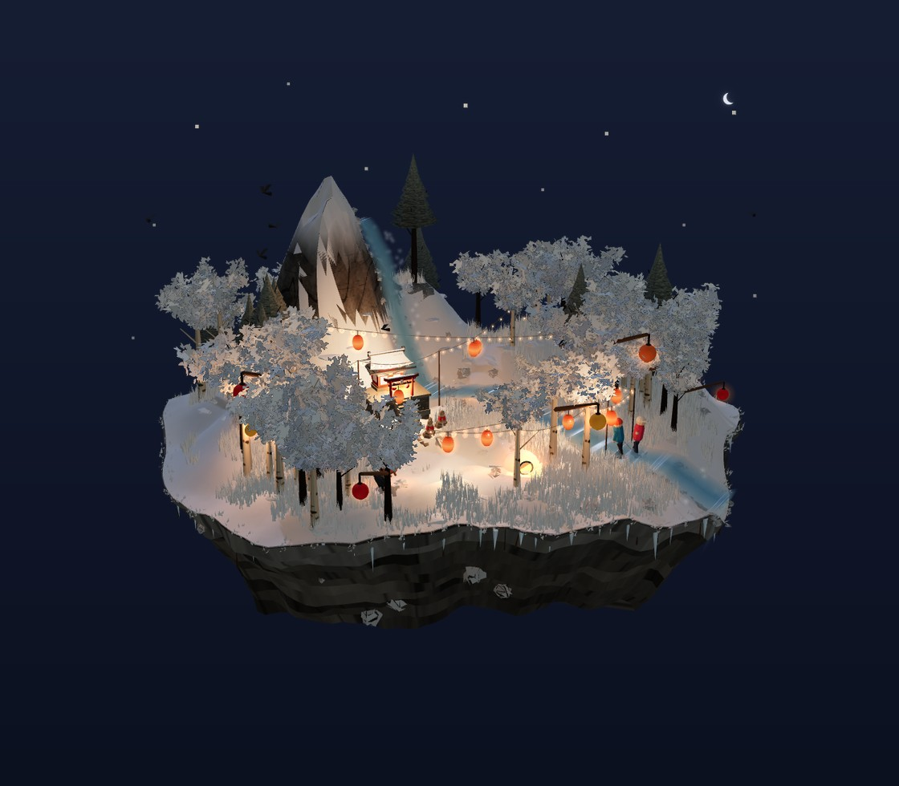
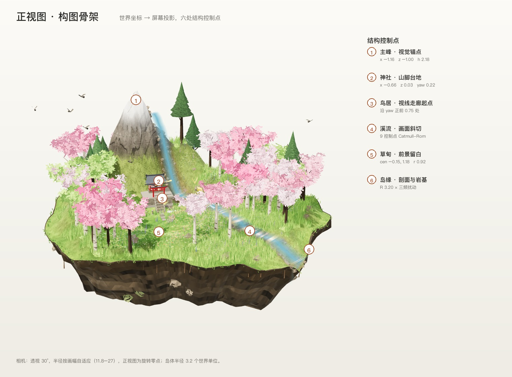

# 四季漂浮岛 · Floating Island

> 一座会跟着真实日期换季的 3D 小岛。窗口里是桌面摆件，浏览器里是能拖拽旋转的沙盘，也可以批量导出 4 季 × 3 时段的壁纸素材。



<p align="center"><sub>春 · 夏 · 秋 · 冬，同一套几何，只换调色板与光照</sub></p>

---

## 它是什么

一个纯前端的 WebGL 场景：一座主峰带几座次峰、一条从山脚跌出岛缘的溪、一间神社和一座鸟居、五十六棵树、一万一千丛草，加上一圈会飘的云和几只鸟。

它不读图片素材——树冠、草地、岩石、水纹、纸灯笼的贴图，全部由 Canvas 在运行时画出来。所以整个项目打包完是**一个 HTML 文件**，可以直接双击打开。

外面再套一层 Electron 透明窗口，就是桌面摆件：**无边框、置顶、背景透明、平时点击穿透**，指针落到岛上才接收鼠标。

## 亮点

| | |
|---|---|
| **4 季 × 3 时段 = 12 个状态** | 按系统日期判季节、按小时判清晨/正午/夜晚，跨段自动过渡，不需要联网 |
| **零素材依赖** | 所有纹理程序化生成；仓库里没有一张贴图 |
| **单文件产物** | esbuild 打成 IIFE 内联进 HTML，约 850 KB JS，双击即开 |
| **桌面摆件模式** | Electron 透明置顶窗 + 命中区域点击穿透 + 底部手柄拖窗 + 托盘换季 |
| **一套布局，四季共用** | 季节不是四套模型，而是同一个几何上的调色板插值与可见性权重 |
| **可复现的出图管线** | Puppeteer 批量渲染 12 态、投影探针标定构图、错误探针巡检 |

## 12 个状态



| 季节 | 月份 | 主色 | 专属内容 |
|---|---|---|---|
| 春 | 3–5 | 樱粉 + 嫩绿 | 花瓣粒子、满树樱花 |
| 夏 | 6–8 | 饱和青绿 | 花甸、河边钓鱼与野餐的孩子、两只狗 |
| 秋 | 9–11 | 金橙 + 赭红 | 落叶、坐在垫子上看枫叶的两个人、地藏 |
| 冬 | 12–2 | 冷灰蓝 + 雪白 | 积雪、冰柱、滑雪与滑冰、雪洞、树上挑杆灯笼 |

时段差异不是简单调亮度，而是三套独立的光照参数（主光角度/强度、曝光、雾距、半球光、环境光、边缘光）按小时权重混合：

| 时段 | 区间 | 视觉特征 |
|---|---|---|
| 清晨 | 06–11 | 主光压到约 4° 的低角度，长影，雾拉近，暖金偏冷紫 |
| 正午 | 11–17 | 主光接近垂直，雾推远，最亮最饱和 |
| 夜晚 | 17–06 | 月光冷蓝打底，曝光降到 0.5 上下，灯笼接管暖光 |



## 快速开始

需要 Node 18+ 和一个能跑 WebGL2 的浏览器。

```bash
npm install

npm run build          # 打包 → dist/index.html
open dist/index.html   # 直接看，不需要服务器

npm run widget         # 起 Electron 桌面摆件
npm run app            # macOS：打包成 dist/Cactus.app 再打开
```

> `npm run app` 依赖 macOS 的 `sips` / `iconutil` 生成图标，其他平台用 `npm run widget` 即可。

常用脚本：

| 命令 | 作用 |
|---|---|
| `npm run build` | 打包单文件 HTML |
| `npm run build:dev` | 不压缩，便于调试 |
| `npm run shots` | 渲染 12 态透明底 PNG 到 `assets/matrix/`（需要本机 Chrome） |
| `npm run check` | 12 态巡检，输出 `errors: none` 才算通过 |
| `npm run app` | 打包并打开 macOS 桌面版 |

### 截图 / 调试用 URL 参数

打开 `dist/index.html?...` 可以固定任意一个状态，方便出图和对比：

| 参数 | 说明 |
|---|---|
| `widget` | 摆件模式（透明背景、隐藏页面 UI、限帧 32fps） |
| `clean` | 去掉粒子与地面投影，用于出透明底素材 |
| `season=0..3` | 固定季节：0 春 / 1 夏 / 2 秋 / 3 冬 |
| `hour=7.2` | 固定时刻（0–24，可带小数），决定时段与光照 |
| `zoom=1` | 取景缩放 0.55–1.4 |
| `debug` | 把 `__isl / __cam / __scene / __terrain / __life` 等挂到 window，供探针脚本使用 |
| `capture` | 截帧模式：关掉实时循环，改由 `__step(i)` 逐帧推进，用于录 GIF |

例：`dist/index.html?widget&clean&season=3&hour=20&zoom=1`

## 目录结构

```
src/
  config.js        季节/时段的全部规则（月份表、时段区间、轮询间隔、过渡时长）
  seasons.js       四季调色板、12 套光照预设、调色板插值、时段权重
  island.js        地形函数、地表/岩基/雪帽、溪水与跌水、草石树、四季着色
  shrine.js        神社 + 鸟居（含石阶、石灯笼、屋顶积雪）
  life.js          花甸、人物、狗、雪地玩耍、看枫叶的两人、地藏
  lantern.js       夜间灯串、提灯、石灯笼火袋、地面光池
  winterlights.js  冬季限定：树上挑杆灯、鸟居提灯、雪洞
  wildlife.js      鸟群与游鱼
  particles.js     花瓣 / 花粉 / 落叶 / 雪
  textures.js      Canvas 程序化纹理（树皮、叶片、岩石、水面、纸灯…）
  main.js          渲染循环、相机、光照应用、交互、桌面壳 IPC
  index.html       页面骨架与 UI 样式
widget/
  main.cjs         Electron 主进程：透明窗、置顶、点击穿透、托盘、状态持久化
  preload.cjs      IPC 白名单
tools/             出图与探针脚本（Puppeteer，见 tools/README.md）
docs/              设计 / 构图 / 实现文档与配图
```

## 配置：只改一个文件

`src/config.js` 收拢了「什么时候变成什么」的全部规则，改它不用碰渲染代码：

```js
export const CONFIG = {
  // 1 月到 12 月分别属于哪一季（0 春 1 夏 2 秋 3 冬）
  monthSeason: [3, 3, 0, 0, 0, 1, 1, 1, 2, 2, 2, 3],

  // 需要按节气覆盖时加在这里（支持跨年）
  seasonOverrides: [
    // { from: '02-04', to: '05-05', season: 0 },
  ],

  periods: {
    morning: { from: 6, to: 11 },
    noon: { from: 11, to: 17 },
    night: { from: 17, to: 6 },
    falloff: 0.6,        // 边界前后各 0.6 小时做渐变，不是硬切
  },

  pollMs: 5 * 60 * 1000, // 多久检查一次是否跨段
  transitionSec: 1.4,    // 换季交叉过渡时长
};
```

调色板在 `src/seasons.js` 的 `SEASONS` 里：四季的字段结构完全一致（草地双色、苔藓、土、岩石双色、树冠四色、针叶、水、雪权重、各内容权重…），所以可以直接逐字段插值。想改风格，从这里改色值最快。

## 场景规模

一次夜间渲染（冬季，含全部灯火）的实测值：

| 指标 | 数值 |
|---|---|
| 树 | 56 棵（4 种：白桦 / 枫 / 山杨 / 针叶） |
| 实例总数 | 38,518（草 11.5k、树冠、岩石、花、落叶…） |
| 绘制调用 | 389 |
| 三角形 | 217k |
| 程序化纹理 | 26 |
| 光源 | 13（主光 + 补光 + 边缘光 + 反弹光 + 半球光 + 灯火点光） |

没有后处理，没有阴影贴图以外的额外 pass，桌面模式下限帧 32fps，主要开销在窗玻璃外的浏览器里也足够安静。

## 文档

| | |
|---|---|
| [设计想法](docs/DESIGN.md) | 为什么是「写实微缩沙盘」、四季语义怎么定、夜晚灯火的三层结构 |
| [构图规划](docs/COMPOSITION.md) | 镜头与画幅、岛的几何、五个构图控制点、植被分布规则、比例表 |
| [开发代码](docs/DEVELOPMENT.md) | 模块职责、数据流、地形函数、实例化、季节插值、桌面壳、出图管线 |



## 已知边界

- 只针对桌面浏览器和 Electron 调过；移动端能跑但没有专门优化。
- `npm run app` 的打包流程是 macOS only（依赖系统图标工具）。
- 阴影相机是固定 9.2 × 9.2 的世界范围，岛再放大要同步改。
- 场景规模写死在代码里（树 56 棵、草 11,500 丛），改密度需要动 `island.js` 的生成段。

## 许可

代码以 [MIT](LICENSE) 发布，可商用、可修改，保留版权声明即可。

仓库内**不包含**任何个人素材：微信二维码、参考图都由 `.gitignore` 排除，构建时检测不到二维码会自动隐藏那一块 UI，因此 clone 下来可以直接构建。

---

如果这个岛让你的桌面好看了一点，欢迎点个 star，或者 fork 一份改成你自己的季节。
