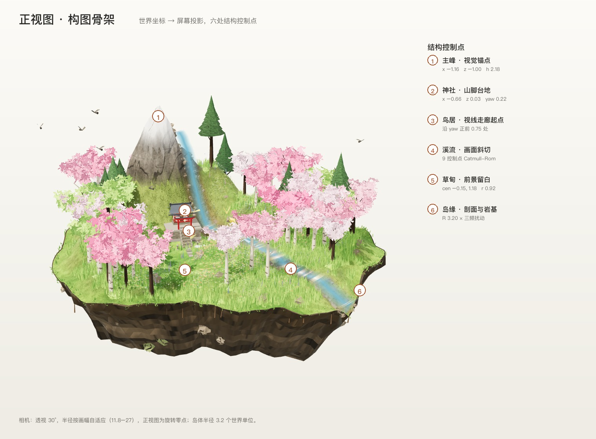

# 构图规划

> 这张图是「正视图 + 六处结构控制点」，由 `tools/probe-compo.mjs` 把世界坐标投影到屏幕像素后标注。下面所有坐标都以它为准，改布局时先用这个脚本验位置，不要靠肉眼估。



---

## 一、画幅与镜头

| 项 | 值 | 原因 |
|---|---|---|
| 透视 FOV | 30° | 长焦压缩，接近微距摄影，避免广角把小岛拍成"玩具球" |
| 相机高度 | `phi = 1.19 rad`（约 22° 俯角） | 能看见草甸的纵深，又能保住岛的侧面厚度 |
| 观察点 | `(0, 0.34, 0)`，摆件模式 `(0, 0.18, 0)` | 略低于岛顶，避免"俯视地图"感 |
| 机位距离 | `3.92 / (tan(15°) × min(aspect,1.5))`，夹在 11.8–27 | 竖屏不裁岛，横屏不过分空 |
| 旋转中心 | 岛组自身 `rotation.y` | 相机不动，岛在转，视线高度始终稳定 |

正视图（`rotation.y = 0`）是唯一被精心调整过的角度，其余角度靠"岛的每一面都有内容"来兜底——这也是为什么岩基要做分层皮肤和垂根，而不是简单的一个倒圆锥。

## 二、岛的几何

岛不是圆盘，是一个被三频正弦扰动的极坐标边界：

```js
const R = 3.2;
const rimR = (a) => R * (
  0.945
  + 0.10 * Math.sin(a * 2.3 + 0.8)     // 大起伏：两三处海湾
  + 0.058 * Math.sin(a * 4.9 + 2.5)    // 中等凹凸
  + 0.026 * Math.sin(a * 8.7 + 1.2)    // 细碎边缘
);
```

半径在 `2.9–3.4` 之间变化。视觉上这很重要：正圆形的岛一眼就是程序生成的，而这三个不同频率叠加出来的边缘，看起来像被啃过一口的真土块。

高度沿边缘做倒角，让草地"卷"下去接到岩壁：

```js
const edge = smoothstep(rr - 0.85, rr, r);
y -= 0.26 * edge * edge;
```

## 三、三层景深

构图按"远—中—近"三层组织，每层只有一个主角：

| 层 | 位置 | 内容 | 作用 |
|---|---|---|---|
| 后景 | 左后 `x −1.16, z −1.00` | 主峰（h 2.18）、针叶林、瀑布源头 | 定住画面的重量，给天空留出负形 |
| 中景 | 左中 `x −0.66, z 0.03` | 神社、鸟居、石阶、地藏 | 视觉焦点，唯一有"人造物"的地方 |
| 前景 | 中下 `x −0.15, z 1.18` | 草甸、人物、野餐、溪流末端 | 承接视线，提供故事 |

主峰偏左而不是居中，神社在主峰右下方，溪流从两者之间穿过并向右前方斜切出去——这条斜线是整张图的动势来源，避免了对称的呆板。

山的轮廓由六个高斯丘叠加：

```js
y += gauss(x, z, -1.16, -1.00, 2.18, 1.18);  // 主峰
y += gauss(x, z, -0.10, -1.60, 1.05, 1.15);  // 后侧次峰
y += gauss(x, z,  1.10, -0.68, 0.58, 1.24);  // 右肩
y += gauss(x, z, -1.90,  0.36, 0.46, 1.06);  // 左侧小丘
y += gauss(x, z,  0.46,  1.26, 0.16, 1.20);  // 前景微隆起
y += gauss(x, z, -2.10, -0.62, 0.28, 0.82);  // 左缘
```

主峰范围内再叠一层"脊状噪声"（`1 - |fbm × 2 - 1|`），否则高斯丘会是光滑圆锥，看起来像布丁。

## 四、溪流：画面的斜切线

溪流是一条 9 个控制点的 Catmull-Rom 曲线，从山脚一直流到岛缘然后跌出去：

```js
const PATH_PTS = [
  [-0.92, -1.34], [-0.58, -1.02], [-0.22, -0.64], [0.20, -0.20],
  [0.62, 0.32], [1.02, 0.88], [1.42, 1.42], [1.86, 1.84], [2.34, 2.32],
];
```

它承担三个功能：

1. **分割。** 把岛分成"左：山与神社"和"右：林与草甸"两块，避免所有内容挤在中间。
2. **引导。** 从主峰脚下（视觉重心）出发，把眼睛带向右下角的岛缘断口。
3. **出口。** 跌水垂到岩壁外面，让"漂浮"这件事有了一个物理上的理由——水从岛上掉下去了。

河道宽度沿程变化（`0.40 → 0.50`），并在中心下切 `0.205`，边缘再缓一层，所以草是"长到河边"而不是"贴在河边"。

## 五、鸟居视线走廊

这是整个项目里最容易被忽略、又最影响观感的一条规则。

神社和鸟居有朝向（`yaw = 0.22`），所以不能简单用"离神社多远"来避让——必须建立一个局部坐标系：

```js
const FWD  = { x: Math.sin(yaw), z: Math.cos(yaw) };  // 正前
const SIDE = { x: FWD.z, z: -FWD.x };                 // 横向

const toriiFrame = (x, z) => {
  const dx = x - SHRINE_SITE.x, dz = z - SHRINE_SITE.z;
  return { f: dx * FWD.x + dz * FWD.z, l: dx * SIDE.x + dz * SIDE.z };
};
```

走廊是一个 `f ∈ (−0.25, 1.72)`、`|l| < 1.00` 的矩形。规则分两步：

**① 生成阶段不放树**：`canPlant()` 里直接返回 `null`。

**② 事后迁移**：已经生成的树如果落进更宽的走廊（`1.16 / −0.10 / 1.86`），顺着溪流法线方向挪到河岸上——给四个距离档位 `0.60 / 0.76 / 0.92 / 1.08`、两侧都试，取"离鸟居最远"的合法点；实在没地方才删。

**③ 定点剔除**：最后仍挡在草地上的四棵，按世界坐标硬删：

```js
const PRUNE = [[0.47, 2.13], [0.45, 2.47], [0.80, 2.25], [0.79, 2.47]];
```

为什么不干脆把这一片设为不毛之地？因为那样会留下一个明显的"环形缺口"，比遮挡更假。迁移 + 定点剔除能保住树群的密度，只是在关键位置上退让。

## 六、植被分布规则

树的生成不是随机撒点，是「先找簇心，再在簇内撒」，最后用一张拒绝表过滤：

| 规则 | 阈值 | 目的 |
|---|---|---|
| 离岛缘 | `> rimR(a) − 0.22` | 不让树挂在崖边 |
| 海拔 | `y ≤ 1.30` | 雪线以上不长树 |
| 主峰核心 | 距 `(−1.16, −1.00) > 0.86` | 保住山顶的裸岩 |
| 神社 | 距 `(−0.66, 0.03) > 0.84` | 建筑不穿模 |
| 鸟居走廊 | `f ∈ (−0.25, 1.72), |l| < 1.00` 内不放 | 视线通透 |
| 草甸 | 距 `(−0.15, 1.18) > 0.92` | 前景留白 |
| 溪流 | `> 0.46` | 河岸不被树吃掉 |
| 坡度 | `≤ 0.62` | 不站在陡坡上 |
| 落差 | 四向 `≤ 0.42` | 不悬空 |
| 树间距 | `> 0.195` | 不挤成一坨 |

树种按海拔分配：高于 `0.82` 或靠近主峰时，76% 概率出针叶；低处则是白桦为主，混枫与山杨。这个倾向让"山上是深绿针叶林、山下是浅色阔叶林"的层次自然形成，而不是靠手工摆。

数量：**22 个簇心 → 簇内 2–6 棵 → 120 次随机补点 → 19 处定点补植**，最终过完所有规则剩下 **56 棵**。

## 七、人物与道具点位

| 对象 | 世界坐标 | 说明 |
|---|---|---|
| 草甸中心 | `(−0.15, 1.18)` r 0.92 | 留白区，禁止种树 |
| 夏季野餐（黄帽小孩） | `(−0.68, 1.09)`，朝向 `0.78 rad` | 鸟居左前平地，面向右前 45° |
| 秋季两人 | `(−0.30, 1.24)` 附近 | `pickSpot` 在 ±0.44/±0.34 内挑平地，避开溪与树根 |
| 地藏 | 神社局部 `(0.098, 0.800)` / `(0.252, 0.766)` | 石阶脚下，用 yaw 换算到世界坐标 |
| 冬季雪洞 | `(−1.30, 1.75)` / `(0.35, 1.72)` | 岛前沿草地，洞口朝镜头 |
| 冬季树灯 | 8 个目标点 →最近的树 | 由左到右连成光带 |

地藏、雪洞这些"贴地物件"必须先算 `terrain(x, z)` 再抬高，且要按神社的 `yaw` 换算局部坐标——在局部系里摆好，再整体旋转，比在世界坐标里凑角度可靠得多。

## 八、比例表

以岛半径 `R = 3.2` 为基准，所有尺度对齐这张表：

| 元素 | 世界尺寸 | 相对 R |
|---|---|---|
| 岛半径 | 3.20 | 1.00 |
| 岛体总高（含岩基） | ≈ 4.3 | 1.34 |
| 主峰海拔 | 2.18 | 0.68 |
| 树高 | 1.0 – 1.5 | 0.31 – 0.47 |
| 树干高 | 0.82 × 树缩放（0.76–1.30） | — |
| 神社屋脊 | ≈ 0.67（台地 0.27 + 屋脊 0.40） | 0.21 |
| 鸟居高 | ≈ 0.57 | 0.18 |
| 人物身高 | ≈ 0.44 | 0.14 |
| 纸灯笼球半径 | 0.074 × 树缩放 | ≈ 0.03 |
| 草丛单株 | 0.042 – 0.084 | 0.013 – 0.026 |

人物身高 0.14 R 是刻意偏大的——按真实比例（人 ≈ 1.7m，岛 ≈ 100m）应该是 0.017 R，那样人在图上只有 5 个像素，故事就没了。**微缩景观的尺度不是物理正确的，是叙事正确的。**

## 九、构图检查清单

改布局时按这个顺序过一遍：

- [ ] 正视图里，主峰、神社、草甸是否构成一个稳定的三角？
- [ ] 有没有任何一棵树压在鸟居的竖向轮廓上？
- [ ] 溪流是否从山脚一路连到岛缘，中间没有被植被截断？
- [ ] 前景草甸是否还有一块能放得下人物的空地？
- [ ] 岛的轮廓线是否有至少三处凹凸，而不是接近圆？
- [ ] 转 90° / 180° 后，是否还有可看的东西？
- [ ] 缩小到 320px，神社是否还能被找到？
