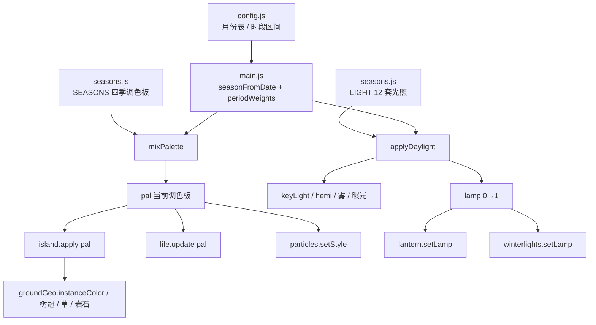

# 开发代码

> 技术选型、模块边界、关键实现和验证手段。想改代码的话，先看第三节的数据流。

---

## 一、技术栈

| 层 | 选型 | 为什么 |
|---|---|---|
| 渲染 | Three.js r187 | 不需要引擎的重量，又比裸 WebGL 省太多事 |
| 打包 | esbuild | 打成 IIFE 内联进 HTML，产物是**一个文件**，可以 `file://` 直接打开 |
| 桌面壳 | Electron 45 | 透明无边框窗、点击穿透、托盘，都是现成的 |
| 出图 | puppeteer-core + 本机 Chrome | 复用系统的 Chrome，不额外下 Chromium |
| 框架 | 无 | 只有一个 canvas，React/Vue 在这里是纯负担 |

没有 TypeScript、没有测试框架、没有 CI。这个项目的验证方式是**出图对比**，不是单元测试——视觉工程就应该用视觉的方式验收。

## 二、模块职责

| 文件 | 行数 | 职责 |
|---|---|---|
| `src/config.js` | 45 | 季节/时段的全部规则；`seasonFromDate()` |
| `src/seasons.js` | 313 | 四季调色板、12 套光照预设、`mixPalette`、`periodWeights` |
| `src/island.js` | 1595 | 地形函数、地表/岩基/雪帽、溪水与跌水、草石树、四季着色 |
| `src/shrine.js` | 420 | 神社 + 鸟居 + 石阶 + 石灯笼（含屋顶积雪） |
| `src/life.js` | 1320 | 花甸、人物、狗、雪地玩耍、看枫叶的两人、地藏 |
| `src/lantern.js` | 435 | 夜间灯串、提灯、火袋、地面光池 |
| `src/winterlights.js` | 339 | 冬季限定：挑杆灯、鸟居提灯、雪洞 |
| `src/wildlife.js` | 148 | 鸟群、游鱼 |
| `src/particles.js` | 244 | 花瓣 / 花粉 / 落叶 / 雪 |
| `src/textures.js` | 381 | Canvas 程序化纹理（树皮、叶片、岩石、水面、纸灯…） |
| `src/main.js` | 737 | 渲染循环、相机、光照应用、交互、桌面壳 IPC |
| `widget/main.cjs` | 477 | Electron 主进程 |
| `tools/*.mjs` | — | 出图与探针（见第七节） |

依赖方向是单向的：`main.js` 依赖所有构建函数，构建函数之间只通过 `island` 对象和 `palette` 交换数据，没有循环依赖。

## 三、数据流



用一句话概括：**季节决定调色板，小时决定光照，两者独立计算后叠加到同一批材质上。**

这个分离很重要——它意味着你可以半夜换季（灯笼亮着，树从绿变红），也可以在同一天里看清晨到夜晚（树的颜色不变，光在变），两套逻辑互不干扰。

## 四、启动时序

```
main.js
 ├─ WebGLRenderer（alpha:true, ACESFilmic, PCFShadow）
 ├─ PMREM 环境贴图（程序化渐变球 + 一个高亮球）
 ├─ 相机 / 光照 / 地面接触阴影
 ├─ season = URL ?season : seasonFromDate()
 ├─ island  = buildIsland(21)        ← 种子固定，布局可复现
 ├─ wildlife = buildWildlife(9, island.trees)
 ├─ life     = buildLife(island, 5)
 ├─ lanterns = buildLanterns(island)
 ├─ winterLights = buildWinterLights(island)
 ├─ 粒子场
 ├─ resize() → fitRadius()
 ├─ applyPalette() → applyDaylight()
 └─ requestAnimationFrame(loop)
```

种子固定（`21 / 9 / 5`）是刻意的：所有"随机"都来自 `mulberry32(seed)`，所以每次构建出来的是同一座岛。要换一座，改种子即可。

## 五、关键实现

### 1. 地形是一个纯函数

没有高度图。整座岛由 `terrain(x, z)` 一次算出：

```js
export function terrain(x, z) {
  const r = Math.hypot(x, z);
  const rr = rimR(Math.atan2(z, x));          // 不规则岛缘
  let y = baseHeight(x, z);                    // 六座高斯丘 + 脊噪声
  const { d, i } = distToStream(x, z);
  const w = 0.40 + 0.10 * (i / STREAM_RAW.length);
  const k  = 1 - smoothstep(0, w, d);          // 河道中心下切
  const k2 = 1 - smoothstep(w, w * 2.4, d);    // 河岸缓坡
  y -= 0.205 * k * k + 0.05 * k2;
  const edge = smoothstep(rr - 0.85, rr, r);   // 岛缘倒角
  y -= 0.26 * edge * edge;
  return y;
}
```

好处是所有东西共享同一套地面：树、草、人、灯笼、地藏、雪堆，都调同一个函数取高度，永远不会出现"树悬空"或"人陷进地里"。

代价是每次调用要遍历 176 个溪流采样点找最近距离，所以**构建阶段**是 O(n×176)，运行时只在需要时调用（都不在每帧循环里）。

### 2. 生成用拒绝采样，不用手摆

```js
const canPlant = (x, z) => {
  const rr = Math.hypot(x, z);
  if (rr > rimR(Math.atan2(z, x)) - 0.22) return null;   // 崖边
  const y = terrain(x, z);
  if (y > 1.30) return null;                             // 雪线
  if (Math.hypot(x - PEAK.x, z - PEAK.z) < 0.86) return null;
  if (Math.hypot(x - SHRINE_SITE.x, z - SHRINE_SITE.z) < SHRINE_SITE.r) return null;
  if (inToriiClear(x, z)) return null;                   // 鸟居视线走廊
  if (Math.hypot(x - MEADOW.x, z - MEADOW.z) < MEADOW.r) return null;
  if (distToStream(x, z).d < 0.46) return null;
  if (slope > 0.62) return null;                         // 陡坡
  if (drop  > 0.42) return null;                         // 落差
  // 间距检查…
  return { y, slope };
};
```

先撒 22 个簇心，每簇 2–6 棵，再 120 次随机补点，最后 19 处定点补植。全部过一遍 `canPlant`，剩 56 棵。

这种写法调参非常快——想更密就加簇心，想"这里别长树"就加一条拒绝规则，不用重新摆位。

### 3. 实例化 + 顶点色做体积

三类高频物件全部 `InstancedMesh`：草（11,500 丛，每丛 5 片叶合并成一个几何）、树冠、岩石。整个场景 38,518 个实例、389 次绘制调用。

树的体积感不靠法线贴图，靠**顶点色**：

```js
// 高度（下暗上亮）× 朝向主光的法线（受光面亮）
const hf = 0.86 + 0.30 * smooth(t);          // t = 叶簇相对高度
const lf = 0.82 + 0.34 * Math.max(0, dot);   // dot = 法线与主光夹角
tintGeo(geo, Math.min(1.26, hf * lf));

// 再把整体平均亮度归一化到 1，避免整体压暗
normalizeTint(geo);
```

归一化这一步是关键：如果只乘不除，密集树冠会整体变灰；归一化之后是"暗的地方更暗、亮的地方更亮"，对比度上去了，平均亮度没变。

一个反直觉的取舍：**树冠 `receiveShadow = false`**。物理上不对，但树冠互相投影会在密集处压成黑块，透亮感全失。这条规则救了整个画面。

### 4. 季节 = 同构调色板插值

四季的字段必须一一对应，才能逐字段 `lerp`：

```js
out.canopy[i].copy(a.canopy[i]).lerp(b.canopy[i], t);
out.snow = a.snow + (b.snow - a.snow) * t;
out.sitters = a.sitters + (b.sitters - a.sitters) * t;
```

权重字段（`snow / flowers / folk / play / sitters / jizo / winterLights`）不是布尔开关，是 0–1 的连续量。`life.js` 每帧向目标缓动：

```js
const w = { flowers: 0, folk: 0, dogsA: 0, dogsW: 0, play: 0, sitters: 0, jizo: 0 };
// 每帧: w.x += (target - w.x) * min(1, dt * k)
// 再:   fade(group, w.x)  → opacity / scale / visible
```

所以换季时人物是"淡入并站起来"，不是"啪一下出现"。

### 5. 时段 = 12 套光照的加权和

```js
export function periodWeights(hour) {
  const f = PERIODS.falloff;                     // 0.6 小时
  const toNoon    = sstep(11 - f, 11 + f, h);
  const toNight   = sstep(17 - f, 17 + f, h);
  const fromNight = sstep(6  - f, 6  + f, h);
  const morning = fromNight * (1 - toNoon);
  const noon    = toNoon * (1 - toNight);
  const night   = Math.max(0, 1 - fromNight + fromNight * toNight);
  // 归一化后返回 { morning, noon, night }
}
```

`applyDaylight()` 里不是 `if (morning) ... else if (noon) ...`，而是把三档**全部累加**，权重当系数：

```js
for (const key of ['morning', 'noon', 'night']) {
  const wp = w[key];
  if (wp < 0.0005) continue;
  const a = A[key], b = B[key];                   // A/B = 换季前后的两套
  keyInt   += (a.keyInt   + (b.keyInt   - a.keyInt)   * k) * wp;
  exposure += (a.exposure + (b.exposure - a.exposure) * k) * wp;
  dx       += (a.keyDir[0] + (b.keyDir[0] - a.keyDir[0]) * k) * wp;
  // …颜色同理，用 _pa.copy(a).lerp(b, k) 再乘权重累加
}
```

这样同时支持两个维度的过渡：**季节 k**（0→1 换季）和**时段 wp**（清晨/正午/夜晚的连续混合）。两种过渡共用同一个函数，不会打架。

主光位置最后归一化到半径 11 的球面上，所以"角度"可控、"距离"稳定：

```js
const len = Math.hypot(dx, dy, dz) || 1;
keyLight.position.set(dx / len * 11, dy / len * 11, dz / len * 11);
```

### 6. 雾必须跟着相机

```js
scene.fog.near = radius * fogScale.near;
scene.fog.far  = radius * fogScale.far;
```

`fogScale` 来自当前光照预设（清晨 0.64/1.92，正午 1.06/2.98）。用**相对距离**而不是绝对距离，缩放时画面浓度才不变——这是最早的一个 bug：滚轮放大后岛会被雾洗淡。

### 7. 灯火只有一个总开关

```js
// lantern.js / winterlights.js
function setLamp(lamp, tint) {
  const dim = 0.97 + 0.10 * lamp;
  for (const l of lights) {
    l.mat.color.copy(l.base).multiplyScalar(dim);
    l.mat.emissive.copy(l.base).multiplyScalar(lamp * 0.92 + 0.16);
  }
  haloMat.opacity = lamp * 0.52;    // 光晕
  poolMat.opacity = lamp * 0.24;    // 地面光池
  point.intensity = lamp * 1.7;     // 真实点光（只有几盏）
}
```

`lamp` 由光照预设给出：白天 0、夜里 1，傍晚按权重连续变化。所有灯火（灯串、提灯、纸灯、雪洞）共用这一个值，所以它们永远同步——不会出现"这盏亮了那盏没亮"。

**性能上的关键决定**：地面光池用加色混合的贴片伪造，不给每盏灯配 `PointLight`。真实点光整个场景只有 13 个。

### 8. 桌面壳：透明 + 点击穿透

窗口本身是 `transparent: true, frame: false, hasShadow: false`，并且置顶到 `floating` 层、在所有工作区可见：

```js
win.setAlwaysOnTop(alwaysOnTop, 'floating');
win.setVisibleOnAllWorkspaces(true, { visibleOnFullScreen: true });
win.setIgnoreMouseEvents(true, { forward: true });   // 默认整窗穿透
```

但这带来一个问题：窗口穿透了，岛怎么拖？

做法是**命中区域协商**：渲染端算出岛在屏幕上的椭圆范围，推给主进程；主进程只在指针进入椭圆时才取消穿透。

```js
// renderer：每 500ms 推一次（值不变则不发）
widgetAPI.setHitRect({ cx, cy, rx, ry });

// main：切换穿透
function setInteractive(next) {
  win.setIgnoreMouseEvents(!next, { forward: true });
}
```

椭圆不是随便估的，是从相机投影反算：

```js
const dist = camera.position.distanceTo(hitCenter);
const r = (3.28 / (dist * Math.tan(camera.fov * Math.PI / 360))) * (h / 2);
```

`3.28` 略大于岛半径 3.2，给边缘留一点余量。

**窗口拖动和岛旋转必须分开**，否则用户永远在"转岛"而不是"搬岛"。所以拖动窗口只由底部一根小横条（`#grip`）触发，且由主进程接管 `setPosition`——`-webkit-app-region: drag` 和点击穿透是冲突的，不能用。

托盘菜单负责换季、尺寸（320/420/560/720）、置顶开关、暂停自转、退出；状态写 `~/Library/Application Support/Cactus/widget-state.json`。

### 9. 自动更迭：双端冗余

| 位置 | 周期 | 管什么 |
|---|---|---|
| 渲染端 `main.js` | `CONFIG.pollMs`（5 分钟） | 重新取小时 → 重算时段光照 |
| 渲染端 | 同上 | 日期跨季才 `setSeason`（不抢用户的手动选择） |
| 主进程 `widget/main.cjs` | 10 分钟 | 跨月时重载页面参数，兜底渲染端异常 |

两处都做，是因为桌面摆件可能一开好几天：渲染端负责"当天内的时段变化"，主进程负责"跨天的季节变化"。

手动选季有一个失效条件——`seasonMode: 'manual'` 只在**当天**有效，跨天或日期已落到别的季节就自动回归日历规则：

```js
function activeSeason() {
  const st = stateCache || readState();
  const byMonth = seasonOfMonth(new Date().getMonth());
  if (st.seasonMode === 'manual' && sameDay(st.seasonAt) && Number.isFinite(st.season)) {
    return st.season === byMonth ? byMonth : st.season;
  }
  return byMonth;
}
```

否则用户点了一次"冬"，这座岛就永远是冬天了。

### 10. 构建：一个 HTML

`build.mjs` 只做三件事：esbuild 打包 → 替换 HTML 里的两个占位符 → 写出单文件。

```js
const [beforeBundle, afterBundle] = tpl.split('__BUNDLE__');
const [beforeQr, afterQr] = beforeBundle.split('__QR__');
let finalHtml = beforeQr + `data:image/png;base64,${qr}` + afterQr + code + afterBundle;
```

`code` 里的 `</script` 会被转义成 `<\/script`，避免提前闭合标签。

二维码是**可选**的：仓库不带个人二维码，文件缺失时注入 1×1 透明图并追加 `.qr{display:none}`，所以 clone 下来直接 `npm run build` 就能用。

## 六、渲染管线参数

```js
renderer.shadowMap.type = THREE.PCFShadowMap;
renderer.outputColorSpace = THREE.SRGBColorSpace;
renderer.toneMapping = THREE.ACESFilmicToneMapping;
renderer.toneMappingExposure = 1.12;      // 之后由 applyDaylight 覆盖
renderer.setPixelRatio(Math.min(devicePixelRatio, 2));
```

| 项 | 值 | 备注 |
|---|---|---|
| 阴影贴图 | 2048²，`PCF`，`radius 2.4` | 覆盖范围 ±4.6 世界单位 |
| 环境光 | PMREM 渐变球 | 顶部白、中部米、底部灰，加一个高亮球做高光 |
| 雾 | `THREE.Fog`，随相机缩放 | 见 5.6 |
| 相机 | 30° FOV，near 0.2 / far 120 | 深远比给悬浮碎石留余量 |
| 后处理 | 无 | 体积感靠顶点色 + 环境光 + 反弹光 |

## 七、出图与验证

这部分是项目能持续迭代的原因：**每次改完都能自动出图对比，不靠肉眼记忆。**

| 脚本 | 作用 |
|---|---|
| `tools/shot-matrix2.mjs` | 12 态（4 季 × 3 时段）透明底批量渲染，可指定尺寸与输出目录 |
| `tools/probe-err.mjs` | 12 态巡检：监听 `pageerror` / `console.error`，输出 `errors: none` |
| `tools/probe-compo.mjs` | 冻结正视图 → 投影关键点 → 截图 + 坐标，用于构图标注 |
| `tools/probe-stats.mjs` | 统计绘制调用、三角形、实例数、纹理数 |
| `tools/probe-occl.mjs` / `probe-see.mjs` | 射线检测：某个点是否被遮挡、从相机能不能看见 |
| `tools/shot-anim.mjs` | 连拍 4 帧，验证人物关节真的在动 |
| `tools/update-app.mjs` | 把 `dist` 同步进 `.app` 并重启 |

### 探针方法论

三招，解决三类问题：

**① 投影。** 世界坐标投到屏幕像素，才知道一个物件在图上到底落在哪。人眼对"草甸中心"的判断可以差半个岛。

```js
const v = new THREE.Vector3(x, terrain(x, z) + dy, z).project(camera);
const px = (v.x * 0.5 + 0.5) * SIZE;
```

**② 射线。** 判断"看不见"是位置问题还是遮挡问题：

```js
raycaster.set(camera.position, dir);
const hits = raycaster.intersectObjects(scene.children, true);
// 第一个命中的不是目标 → 被挡了，命中物就是遮挡者
```

**③ 二分隐藏。** 画面出现莫名的光斑/异常时，逐个隐藏分组截图对比：隐藏夜空 DOM → 还在；隐藏冬季灯笼 → 没了。三步定位到具体对象。

`probe-compo.mjs` 里有个细节：**必须在同一帧里冻结旋转、投影、截图**。否则岛的自动自转会让标注和画面对不上——第一次做的时候偏了十几像素，一度以为是投影算错了。

## 八、性能取舍

实测（900×900 视口，冬季夜，全部灯火）：

| 指标 | 数值 |
|---|---|
| 绘制调用 | 389 |
| 三角形 | 217k |
| 实例总数 | 38,518 |
| 纹理 | 26（全部 Canvas 生成） |
| 光源 | 13 |

做过的取舍：

- **实例化一切能实例化的。** 一万多丛草如果逐丛 Mesh，绘制调用会直接上千。
- **光池用贴片，不用光源。** 每盏灯一个 `PointLight` 是性能杀手；整片灯串只留 3 个。
- **树冠不接收阴影。** 省一遍采样，还顺带解决了压黑。
- **桌面模式限帧 32fps。** 一个静止的摆件没必要跑 120 帧，省电、省风扇。
- **`pixelRatio` 上限 2。** Retina 上 3x 的收益极小，开销翻倍。
- **窗口不可见时停帧。** `document.hidden` 直接跳过 `render`。

## 九、扩展指南

**加一种季节内容**（例如"春天的风筝"）：

1. `seasons.js` 四季各加 `kite: 0/0/0/0`（春为 1）；
2. `clonePalette` / `mixPalette` 各补一行；
3. `life.js` 里建组、写 `update()` 按 `w.kite` 淡入淡出；
4. 需要贴地的，用 `terrain(x, z)` 取高度。

**加一种树**：在 `island.js` 的 `pushTree` 里扩 `sp` 分支，`bySpecies` 分组后各建一个 `InstancedMesh`，调色板里加一个色槽。

**改时段划分**：只动 `config.js` 的 `periods`。注意 `periodWeights` 目前是三段硬编码（早/中/夜），要加第四段得改函数本体。

**改岛形**：`R` 与 `rimR` 三个正弦的系数决定轮廓；`baseHeight` 里的六个 `gauss()` 决定山形。改完记得跑 `probe-compo`，确认神社、鸟居、草甸没有被新地形顶穿。

## 十、已知问题

- 阴影相机是固定 ±4.6 的世界范围，岛放大后会缺影，需要同步改。
- 树的密度（22 簇 / 120 次 / 19 处）写死在生成段，没有配置化。
- 桌面壳的打包脚本是 macOS only（`sips` / `iconutil` / `.app` 目录结构）。
- 移动端没有专门适配：能跑，但触摸手势和性能都没调。
- 没有场景持久化，改动只能靠改代码 + 重新构建。
